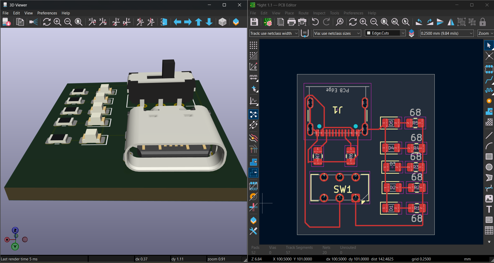

# Light 1.1 - USB-C Desk Light

A compact, custom-designed USB-C powered LED desk light. This was my first project focused on USB-C power negotiation and parallel component routing.

## 📝 Project Overview
This board takes 5V from any standard USB-C charger and powers 5 white LEDs. It features a physical slide switch for on/off control and uses the standard 5.1kΩ CC resistor configuration to ensure modern smart chargers output power.

## ⚙️ Technical Specifications
*   **Input:** USB-C (5V)
*   **Power Draw:** ~150mA (5 LEDs @ ~30mA each)
*   **Connector:** 16-Pin USB-C Receptacle
*   **Switch:** DPDT Slide Switch (SMD)
*   **Board Layers:** 2-Layer (Top Copper only used for routing)
*   **Dimensions:** [Insert your exact board dimensions here, e.g., 25mm x 20mm]

## 📁 Repository Structure
*   **`/Hardware`**: KiCad schematic (`.kicad_sch`) and PCB layout (`.kicad_pcb`) source files.
*   **`/Gerbers`**: Manufacturing ZIP file (ready for JLCPCB).
*   **`/Images`**: 3D renders and DRC (Design Rules Check) screenshots.

## 🛠️ Design Details & Lessons Learned
*   **USB-C Handshake:** Integrated 5.1kΩ pull-down resistors on CC1 and CC2 to unlock 5V from smart chargers.
*   **Current Limiting:** Each LED is paired with a 68Ω resistor to limit current to ~29mA, preventing burnout.
*   **The "Ladder" Routing:** Learned how to properly route parallel components by separating the 5V rail and the Ground rail to avoid accidental short circuits.
*   **Design Verification:** Passed DRC with 0 Errors and 0 Unconnected Items.

## 🖼️ Design Gallery

*(Note: Ensure the image filename matches your uploaded file)*
